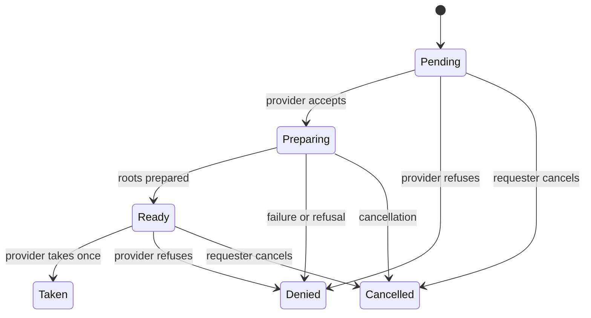

# Launch request ownership / Владение запросом запуска (runtime0.166)

This release adds a native request/accept/handoff lifecycle on top of the
[pre-init environment SDK](LAUNCH-ENVIRONMENT.md). It is **not yet a network
launch service**: no authenticated wire exchange, automatic remote module call,
FD wire encoding or FlashVM terminal proxy is added. No provider Dis code is
downloaded for execution at the terminal.

Добавлен native lifecycle запроса: терминал получает право просмотра/отмены,
провайдер — право подготовки и одноразового получения окружения. Это следующий
этап перед сетевым адаптером, а не готовый удалённый запуск.

## Authority and immutable request / Полномочия и запрос

[`vfs/launch/ticket.h`](vfs/launch/ticket.h) defines two opaque C capabilities:

| Capability | Operations |
| --- | --- |
| `DVM_LaunchTicket` | Observe state, retain an independent change journal, cancel unfinished request |
| `DVM_LaunchRequest` | Read copied description/argument slices, select provider root, prepare, refuse and take |

Creation takes a granted terminal root, its copied source association, expected
provider systemid, explicit terminal-first policy, logical module name and up to
65536 startup bytes. Input metadata/bytes are copied before capabilities escape.
The logical name is not resolved against the host filesystem. Startup bytes have
no assigned network encoding and grant no native/managed pointer authority.
FD and terminal-interface capabilities are separate future transport work.

Creation performs no provider I/O or authentication. The trusted launch adapter
must associate identities with authenticated granted capabilities, route only the
provider request to the proper owner and enforce aggregate admission quotas.
The request is bounded individually; no global service queue/listener is claimed.
The requester never receives the provider root or prepared namespace through its
status capability. C type separation is an SDK contract, not a sandbox against
arbitrary trusted native memory access.

Both roots must advertise PATH cancellation and CAPTURE where fresh dot capture
requires a callback. Invalid/legacy terminal roots are refused at creation;
unsupported provider roots are refused before admission. The older direct
`dvm_launch_prepare` API retains its documented unscoped legacy mode. This new
cancellable ticket lifecycle does not invent interruption guarantees for legacy
native I/O; adapters need capable providers, for example eligible Styx roots.

## State transitions / Состояния

A wrong provider identity/session or invalid preparation input does not consume
Pending, so the owner can correct its selection. Once admitted, preparation is
attempted once; failures are terminal and there is no implicit retry or replay.
Ready means a private complete namespace is available. Taken means ownership was
transferred, **not that a process started or init ran**. Running/exited state and
post-handoff supervision belong to a later execution capability.

Provider preparation captures roots outside the request mutex. The complete
terminal-first namespace is published under the mutex only if preparation is
still admitted and cancellation has not won. No partial namespace is exposed.
Explicit requester cancellation/refusal can remove Ready before take. The same
mutex decides a concurrent take/cancel race: exactly one wins. Cancellation after
Taken cannot revoke the transferred environment.

Take allocates an independent handoff and startup copy before consuming Ready.
Allocation failure leaves Ready available. Concurrent takes produce one winner;
losers receiveNULL. Handoff owns its namespace and copied metadata/arguments even
after both capabilities are retired. The consumer may move group to the future
instance owner, clear that field and free the remaining handoff. Nothing calls
init, enters a foreign Prog or changes a running guest's namespace here.

Подготовка проходит вне mutex. До выдачи окружение можно отменить или отклонить;
после выдачи это уже отдельное владение. Неудачная allocation при take не
поглощает результат. Создания остановленного гостя или global stop здесь нет.

## Cancellation and notifications / Отмена и уведомления

Each request owns an independent native cancellation source. Preparation enters
its source on the provider's current OS thread. If the caller already has an
outer native source, a forwarding tap retains **only the independent native
source**, never the request, provider, Prog or managed pointers. Sticky outer
cancellation propagates before root callbacks, including pre-cancelled entry.
The inner scope and forwarding tap are removed before return; the outer scope
identity is restored. Requester cancellation cannot cancel unrelated outer work.

Cancel/refuse changes state under the request mutex, then unlocks before native
signals, namespace cleanup and notices. After a blocked metadata callback
acknowledges, cancellation prevents acquisition of the next root or publication
of Ready. Ready commit wins later outer-source cancellation; explicit ticket
cancel remains available until take. Callers must keep borrowed wrappers/roots
alive through operations and join same-wrapper callers before freeing them.
Opposite capabilities and concurrent take/cancel operations are mutex protected.

The SDK itself has no guest PID ledger. A guest/network adapter must register its
native wait and release managed admission before potentially blocking provider
I/O, then return through its normal cancellation/reentry path. The native SDK
never asks a guest to process a queue or cooperatively service cancellation.

`dvm_launch_observe` returns an independently retained existing change journal.
Native notice subscribers receive invalidation hints; the authoritative state
must be read from the live ticket. Hints may coalesce or arrive after a newer
state, so they are not a complete transition log. Subscribers use independent
native recipient state and never execute/pause a guest. No new event wire format
or implicit per-thread device registration is introduced.

Dropping an unfinished requester cancels; provider abandonment refuses. Prepared
namespaces retire outside the state mutex. Accepted handoffs survive both drops.
Terminal-root pins and immutable request bytes retire with the last capability;
external change journals can outlive it without retaining request/provider state.

## Verification / Проверки

Three native tests cover immutable byte slices and logical names, wrong owner,
pending/ready cancellation and refusal, requester/provider abandonment, one
preparation, two simultaneous takes and64 take/cancel commit races. Handoff data
and namespace are exercised after both capabilities are freed. Actual native root
waits cover requester cancel, provider refusal, outer-source cancellation,
pre-cancel, cancellation at the final root and a competing preparation attempt.
No timing sleeps or guest polling are used; callback admission is signalled by
native condition variables, with exact independent-context retirement.

Allocator tests inject refusal through constructor allocations, outer-source
forwarding/private preparation allocations and both handoff allocations, verifying rollback, root ownership and preserved Ready. They exposed
and now cover a pre-existing cancellation-source constructor error: failed mutex
creation attempted to destroyNULL. Cleanup now guards the missing mutex. A native allocation index also requires
all ticket/preparation/handoff allocations to reach free after the scenarios.
ASan/UBSan checks pass with leak detection disabled; enabling LeakSanitizer in
this execution environment fails inside LeakSanitizer before reporting results,
so no LeakSanitizer success is claimed.
Private controls removing the independent preparation scope or one-use take
check fail in actual native callbacks/lifecycle checks.

The real interpreter/JIT launch-environment fixture now performs request creation,
provider acceptance and one-use handoff before appinit. It retires both
capabilities, then uses ordinary VFS operations in the transferred environment.
It remains a local bootstrap fixture, not proof of network/remote execution.

The native suite has274 cases and passes normally and under ASan/UBSan with
`detect_leaks=0`. Both dynamic/static guest builds pass29 selected VFS/process
cases and41 host-unit cases. The interpreter/JIT pre-init fixture passes ten
repeated runs. Ownership checking in the allocation test uses its native
allocation/free index, not a successful LeakSanitizer run.
