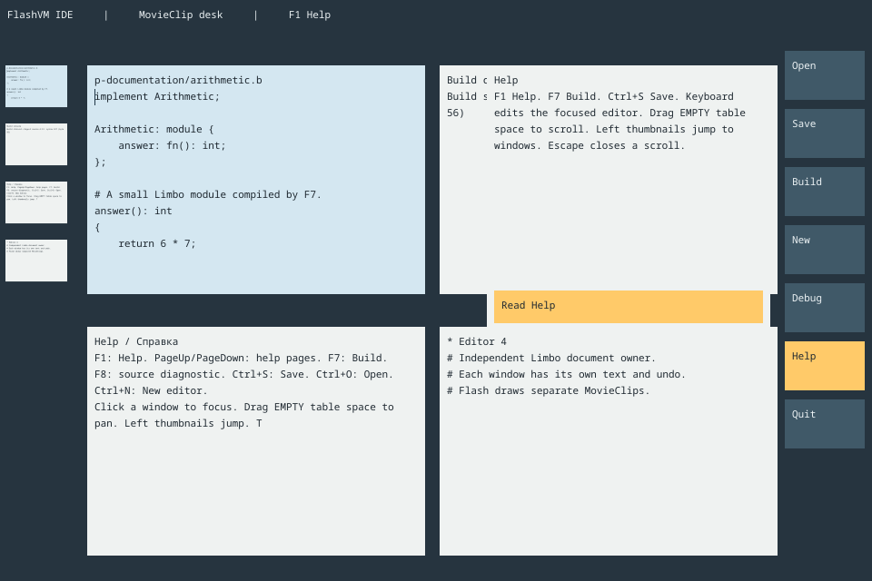

# v0.1673 — MovieClip desk with independent Limbo owners

[English desktop guide](../../ide/DESKTOP.md) · [Подробное руководство](../../ide/DESKTOP.ru.md) · [Previous series](v0.1672.md)

## Реализовано

Рабочий стол — настоящий граф MovieClip, а не обзор поверх одного редактора.
Стол, окна, миниатюры, кнопки и свитки — отдельные Flash-объекты. AS2 управляет
свойствами и текстом через обычный путь Coco/R → FIR → оптимизация → SWO → SWL → SWF8.
Нативный адаптер предоставляет стандартные примитивы MovieClip; полный AS2 ещё
не заявляется. Временные фиктивные прямоугольники не заменяют Flash-граф.

Каждый редактор — отдельный процесс Limbo с собственными Idecore/Ideinput,
историей undo, путём, dirty/revision и каналом ответов. Консоль и Help также
имеют отдельных владельцев. Процессы кооперативные: это не заявление о параллельном
исполнении нескольких нативных VM. Между Dis и Flash передаются значения,
никаких общих указателей куч или объектов GC.

Новая оболочка запускается как `desktop-ide.dis` или установленным
`run-desktop-ide.sh`. Старый `ide.dis` сохранён как отдельное приложение.
Доступны два начальных редактора и новые окна до общего лимита 8,
Open/Save, Ctrl+N, F7 со сборкой настоящего исходника и F8 с переходом к диагностике,
живые уменьшенные копии окон слева, свитки действий справа, Help и прокрутка
стола за пустое место. Потеря фокуса и устаревший ticket отменяют жест.
Несохранённые документы требуют явного Discard and close.

Это снимок настоящего исполнения: два независимых редактора, результат сборки,
Help, миниатюры и раскрытый свиток. Фото WeTab использовано как ориентир композиции.
Рисование MovieClip выполняется владельцем FlashVM; завершённые пиксели копируются
в отделённый кадр перед фоновой презентацией. Параллельное рисование MovieClip
и физические touch-проверки этим не заявляются.

## Синхронизация и проверки

Inferno experiment: `bfa52530021a9fbd5ca58a69e03042c89a8d9bdd`.
Импортированы защита публикации ALT и сценарии перекрытия/cancel.
Перед публикацией дополнительно импортирован свежий bfa5253: защищённое
заимствование REG нативными входами каналов, освобождение временных владельцев
buffered receive/refill при исключениях и матрицы emu/os. Заголовок vmchannel.h
получает отдельную TLS-адаптацию и проверку свежести реальных входов сборки.
Полная матрица ошибок использует UBSan; невыбрасывающие сценарии дополнительно
проверяются с ASan/UBSan. Эти тесты не заменяют физический запуск ARM64.
Dis 797 + bootstrap 277, 954 уникальных выбранных файлов побайтово сверены
с Git и SHA-256. Новых общих исправлений для обратной отправки не обнаружено;
предыдущие исходящие правки сохранены в Inferno.

- Финальный полный core: 212/212; включает C/RX ALT publication и native channel entry с UBSan/ASan.
- Runtime: все 239 проверок пройдены, включая interpreter/JIT и настоящий FlashVM replay.
  На финальном импорте 215 прошли сразу; 24 проверки компиляции повторены успешно
  с явным `TMPDIR=$PWD/build/tmp`, отсутствовавшим в первом запуске.
  До свежего импорта также был полностью зелёный запуск 239/239.
- После заключительных правок оболочки: 5/5 владельцы/рисование/отделённый кадр.
- Переустановленные editor/runtime SDK: компиляция, перелинковка C99,
  interpreter/JIT и независимые владельцы окон проходят вне исходного дерева.
- Сборка runtime без встроенного компилятора также выполнена.

У всех миниатюр проверяется реальный readback TextField против соответствующего
окна. Проверяются независимые файлы/сохранения, настоящий F7, dirty-close,
Unicode, создание окна, жест за пустое место и отсутствие pan при жесте из окна.

## Следующая интеграция

В новой оболочке ещё отсутствуют мышиное выделение/позиционирование каретки,
clipboard, произвольное перемещение/закрытие отдельных окон, панели экспорта,
графические документы и подключённые Run/Debug-сессии. Пункт Debug это явно
показывает. Существующие возможности одиночного редактора/экспорта остаются
в своих точках входа; их наличие не означает автоматического встраивания сюда.

Viewport передаёт до 200 Unicode-символов вокруг каретки, полный исходник остаётся
у владельца. Используется неизменённый Noto Sans Mono/OFL, размер 11.
