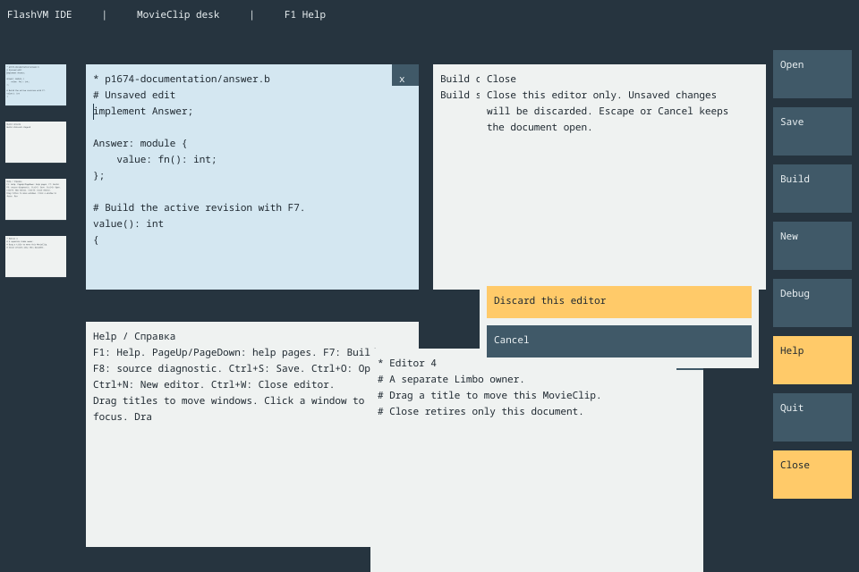

# v0.1674 — Перемещаемые окна и независимое завершение редакторов

[Подробное руководство](../../ide/DESKTOP-LIFECYCLE.ru.md) ·
[English guide](../../ide/DESKTOP-LIFECYCLE.md) · [Предыдущая серия](v0.1673.md)

В настоящем MovieClip-столе заголовок теперь перемещает отдельное окно, а пустое
место по-прежнему прокручивает стол. Тело окна не начинает эти жесты. Фокусируемое
окно рисуется последним и получает события в той же перекрытой области; раскрытые
свитки перехватывают клики по своей площади. Перемещение хранится в layout-процессе
и переживает обновления текста. Это состояние текущего запуска, не файл сессии.

`x`, Ctrl+W и инструмент Close закрывают отдельный редактор. Dirty открывает
модальное решение Discard this editor / Cancel; Escape также отменяет закрытие.
Редактирование и смена цели во время решения блокируются. Сначала приложение
получает терминальное подтверждение Shutdown владельца, затем убирает layout,
миниатюру и кнопку. New создаёт новый процесс документа в освободившемся слоте.
Консоль и Help защищены от отдельного закрытия; остальные документы продолжают
жить со своими путями, undo и dirty. Для сохранения перед закрытием: Cancel,
Ctrl+S, затем Close.

Нативный адаптер очищает TextField/рисунок/каретку отсутствующих клипов и проверяет
чтение пустого текста. Пул клипов ограничен и повторно используется; это не обещание
уничтожения контекста FlashVM при каждом закрытии. Работники представления получают
только завершённые пиксели. Владельцы Limbo кооперативны, общих указателей куч нет.

Добавлен [полностью комментированный переносимый пример](../../ide/dis/examples/desktop-lifecycle/README.ru.md)
с двумя настоящими владельцами, Shutdown/Remove и созданием нового документа.
Он не изображает GUI и не читает/не пишет файлы. Графический пример и SDK используют
те же модули и настоящий FlashVM. Runtime: 0.37.0.

Проверки:

- Полный runtime: **241/241**.
- Заключительные владельцы/рендер/отделённый кадр/генерация: **6/6** перед
  добавлением двух отдельных tutorial-проверок; новый tutorial **2/2**.
- Установленные editor/runtime SDK: компиляция, C99-перелинковка, native JIT и
  interpreter, жизненный цикл и настоящая графическая оболочка проходят.
- Runtime без встроенного компилятора собран; новый tutorial проходит в обоих режимах.
- Все 954 выбранных исходника побайтово соответствуют upstream Git blob/SHA-256.

После заключительного обновления текста Help установленный SDK повторно проверяет
оболочку и tutorial wrapper в обоих режимах. Исходники общего core не менялись;
результат его предыдущей серии — 212/212, новая серия не выдаёт его за новый прогон.

Inferno experiment проверен в обе стороны: `bfa52530021a9fbd5ca58a69e03042c89a8d9bdd`,
797 Dis + 277 bootstrap, 954 уникальных выбранных исходника. Новых входящих
изменений и подтверждённых общих дефектов для исходящего исправления не найдено.
Прошлые исходящие исправления остаются в Inferno; специфичные UI-правки сохранены здесь.

Мышиное выделение/clipboard, resize окон, сохранение сессии, графические документы,
панели экспорта и подключённые Run/Debug ещё не встроены в эту оболочку. Она сохраняет
отдельные существующие точки входа одиночного редактора и экспорта. Физический touch
и другие CPU/OS не объявляются проверенными по headless replay.
