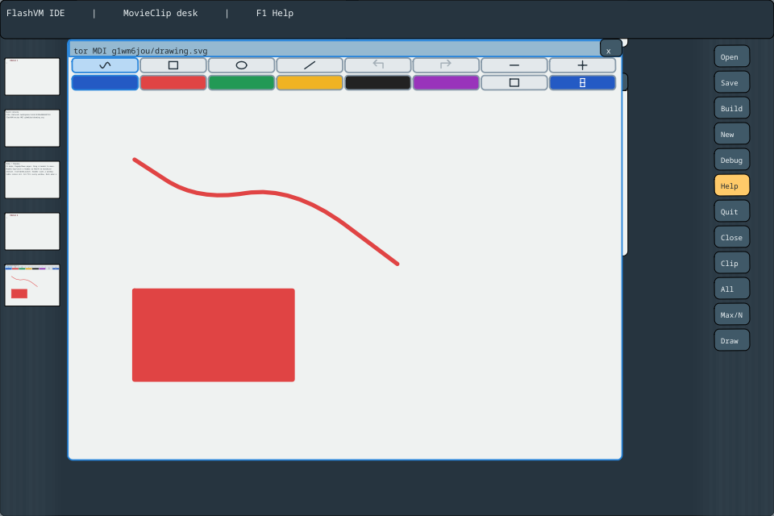

# v0.1697 — Vector controls, SVG interoperability and Linux CPU selection

2026-10-30. Workspace0.1697; engine0.1693 and FIR0.69.0 remain unchanged.
This series makes existing vector authoring accessible through real MovieClip
controls and corrects the Linux runtime's x86-64-only configuration/selection.
No common Dis64 IDs, wire layout or public calling ABI change.

## Linux CPU selection / Архитектуры Linux

CMake previously said “Linux64” while admitting only x86-64 and always compiling
comp-amd64.c. It now selects **AMD64, ARM64 or RV64** and independently checks the
C compiler architecture. Both console and graphical executables use that choice.
`--version` reports the backend. Wrong OS, CPU or pointer width fail explicitly.

Actual AArch64 and RV64 ELF console binaries execute under QEMU user emulation:
channel42, vector model, vector pane ownership, desktop ownership and both plain
and optimized array-alias regression modules, each with interpreter and JIT.
Native-leaf counters are positive only for JIT. This verifies target instructions
and the native backend, not physical-device graphics or a complete platform port.
The cross-built C objects use host-generated NC64 module/header layouts shared by
these LP64 targets. No AMD64 object is linked into the target executable.

**x86-32 and ARM32 are not enabled in this runner.** Its eight-byte pointer/cell
and frame contracts require a distinct 32-bit adaptation. Selecting an old
compiler file does not connect native-PC dispatch or repair Sys/Alt/GC layouts.
The [platform matrix and build instructions](../../disVM/runtime/PLATFORMS.md)
record that boundary and the remaining work explicitly.

На ARM64 теперь выбирается настоящий comp-arm64.c, на RV64 — comp-riscv64.c.
После обновления запускайте обычное меню сборки. Проверены конфигурации AArch64
и RV64 настоящими cross-компиляторами и исполнение консольного runtime под QEMU.
Физические платы, SDL и весь графический стек на них пока не проверены.

## Vector controls and SVG

Each vector pane and its thumbnail contain real child MovieClips for brush,
rectangle, ellipse, line, Undo/Redo, stroke width, six colours and fill. A current
width indicator is display-only. Disabled actions are dimmed; tool/style state
comes from the owning Limbo document. Hits use the composed transforms and route
through typed channels with exact revision/ticket checks. Stale/malformed controls
cannot edit source text. Signed hit cells are explicitly decoded on NC64.

The private copied UI stream is version2 and carries tool/style/history state.
The receiver refuses old/unknown versions and malformed fragments atomically.
This stream is unrelated to the shared Dis64 format.

SVG import accepts a UTF-8 BOM, a strict XML1.0 declaration, well-formed comments
between elements, empty SVG pages and exact integral decimal values such as100.0.
Nonzero fractional values remain rejected rather than rounded. Malformed XML,
unknown processing instructions, entities/DOCTYPE and unsupported drawing features
still fail before document adoption. Canonical export omits metadata and preserves
geometry. Both scalar and encoded-byte input quotas apply.

[Guide EN](../../ide/VECTOR-EDITOR.md) · [Руководство RU](../../ide/VECTOR-EDITOR.ru.md) ·
[Commented example](../../ide/dis/examples/vector/README.md).

## Desktop zoom

Global zoom preserves the projected scroll/pan anchor while keeping document
rectangles unchanged. Opposite zoom steps restore the original translation,
without accumulated integer rounding. Tests maximize a scrolled window, zoom at
empty desktop space, verify the header remains visible and repeat eight cycles.

## Verification

Final compiler-enabled headless IDE/runtime suite after all changes: **311/311**.

- Complete headless compiler-enabled IDE/runtime310/310 before the final anchor
  refinement; final affected anchor/control subset9/9 afterwards.
- Console runtime138/138 after Linux backend selection; final IDE vector/platform
  subset6/6 after the backend/version changes. Menu36/36.
- AArch64 and RV64: six actual NC64 modules each, interpreter/JIT,12 runs per CPU,
  including compiler-generated plain/optimized alias oracles and model ownership.
- Real CMake cross configurations select ARM64/RV64; pure selector checks cover
  aliases and explicit32-bit/unsupported-platform refusal paths.
- Actual mouse UI pixels, transformed/maximized/table-zoomed controls, Undo/Redo,
  SVG save/open/direct launch; relocated installed package and shipped-example
  rebuild were checked. Physical touch/SDL device latency is not measured.
- Inferno source snapshots remain byte-exact at1a98deb32f6409d990fd49771b63c3cc54c753b3:
  DisVM916 files, bootstrap281. INFERNO-0023 remains the latest incoming journal
  message; no new upstream source fix or common-format decision is invented.
