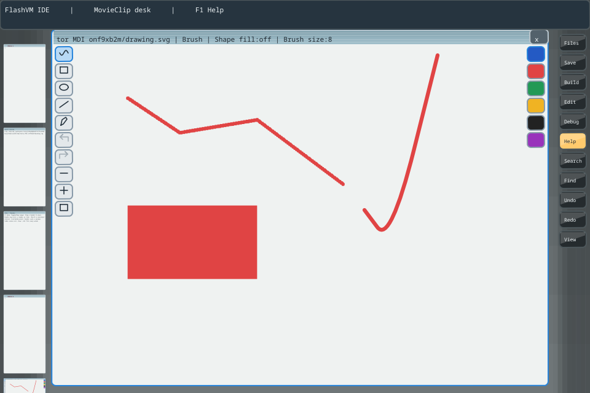

# v0.1718 — Native geometric previews and connected Line figures

The supplied recording shows delayed geometric previews, brush-sized outlines
and ambiguous right-hand Fill/Pen controls. Line/Rectangle/Ellipse previously
used bounded but synchronous per-motion Dis proposals, while Brush/Pen already
had native capture. Geometric motion now stays on the native owner: it retains
only start/latest endpoints, batches SDL input and produces no motion proposals
to Limbo. Native Begin reuses the immutable committed wire body instead of
serializing a portable preview. Release sends the endpoint and opaque token;
the Limbo owner commits geometry without a trajectory/vectorization job.

While held, geometry is an unfilled one-logical-unit destination-XOR outline.
`editor_primitive.h` builds the temporary two-point shape; `editor_xor.h` draws
a coverage mask and reversibly inverts covered destination RGB, preserving alpha.
Ordered dirty tiles provide the underlying drawing and foreground occlusion.
XOR temporarily uses world-command composition rather than pretending it is an
independent alpha bitmap; the first mode transition may repaint the viewport.
Subsequent frames compare contour damage. Release restores ordinary retained
object caching and selected-colour geometry. Brush/Pen retain their independent
native sample buffers and post-release Limbo fitting worker.

Line is now a connected figure. Later drags begin at the preceding endpoint.
Finish (checkmark) ends an open figure. Releasing within eight logical units of
the first node after two existing segments snaps/closes it and admits the Fill
preference. The entire figure is one Undo unit. Tool/colour changes finish an
open figure. Immutable vertices, history, closure and SVG remain in the separate
Limbo algorithm `idevectorchain.b`; no live VM pointer enters a render worker.

Tools are vertical on the left; colours are vertical on the right. Brush diameter
is1..32, changed by +/- and displayed in the caption. Primitives use width1;
Pen keeps its centerline width and cannot become filled. Its inactive tile no
longer uses the current paint colour, which previously made it look selected.
The separate executable AS view `chrome/vector-control.as` draws rounded controls
with copied palette/selection state. Native hit rectangles match actual positions
under the composed window/desktop transform.

The private six-word UI header uses fill bit0 for the preference and bit1 for an
unfinished Line. Command17 is Finish (signed hit offset-18). New document fields
describe immutable chain vertices and native preview ownership. Rebuild matching
`.dis`, `.m` and native products; IDE version is0.7.6. SVG, SWF, Dis, FIR and native64
file profiles are unchanged. No Inferno-owned production file changed here.

## Validation

Native SDL tests drive600 motions for each primitive and Fill-on Pen: only Begin
and frozen End reach the channel. Primitives retain exactly two endpoints; Pen
retains its trajectory. Full-frame and tiled XOR tests invert a coloured baseline
and double application restores it byte-for-byte. Separate raster baselines are
used for each mode because AGG clip translation can round antialias coverage by
one channel level.

Model and real desktop tests cover continuation from an unrelated next press,
Finish, snap/closure/fill, whole-figure Undo/Redo, exact SVG path counts, visible
thin strokes and Fill → Pen. Native Begin's unchanged body/cache is checked
separately. Independent owner, cache, Brush/Pen worker and retained raster cases
remain enabled. Actual UI screenshot:

These are actual Dis interpreter/JIT, native renderer and dummy SDL/headless
replays, not a measured physical-device latency/FPS benchmark. Documentation and
the source SDK include the new helper files. Pull, rebuild the complete
`disvm-editor` package, and launch menu item8.

[English guide](../../ide/VECTOR-EDITOR.md) ·
[Русское руководство](../../ide/VECTOR-EDITOR.ru.md).

Acceptance:27 affected cases passed on the final capture/model implementation;
a further six control/XOR/native cases passed after the inactive Pen styling
correction. Build-menu37/37, installed menu dispatch in both modes, installed
connected Line/Fill/Pen authoring and the installed SVG/pixel screenshot scenario
passed. The package was rebuilt with all dependent Dis modules.
