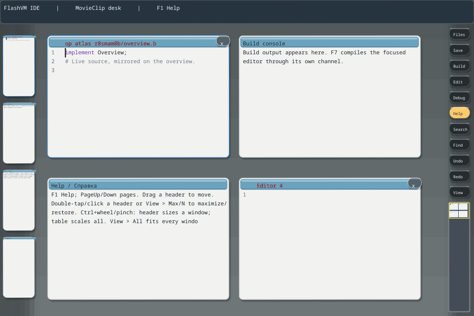

# FlashVM v0.1719 — desktop atlas and layered chrome

The MovieClip IDE now has a fixed overview at the bottom of the right toolbar. The desktop is a finite seven-screen vertical strip. The overview shows live window miniatures and a viewport frame; clicking or dragging it navigates the desktop. Hidden windows remain on the left shelf. Toolbar buttons scroll independently above the overview.

The first finger selects the owner of a three-finger pan: desktop, left shelf, or right toolbar. Toolbar commands run on release, so adding fingers or starting a scroll cancels a pending command. Adding a second contact also cancels native drawing capture without leaving a brush dot.

Window cards, title bars, thumbnails, tabs, fields and buttons now use rounded faces, bevels and shadows. Appearance remains in ActionScript; Limbo owns geometry and interaction. The C `ideDraw.round` primitive supplies generic drawing. See [the chrome and atlas guide](../../ide/CHROME-ATLAS.md) and [Russian guide](../../ide/CHROME-ATLAS.ru.md).

## Implementation

- `ideatlas.b/.m`: pure geometry, finite bounds, viewport projection and navigation. At 960×640 the map is 44×223 pixels. Height is capped at half the IDE height and further reduced when necessary to preserve one toolbar button at minimum window size.
- `idedesktopatlas.b`: scene composition using actual window mirrors, without creating document owners.
- `idedesktoptools.b`: release-time command admission.
- `ide/as/chrome`: separately compiled ActionScript views, including atlas background, miniature and frame.
- Native input preserves first-contact ownership and suppresses phantom single-finger gestures after multi-touch. Private `ContactCancel` code 11 and scene IDs do not change the Dis64 format.
- Installed SDK includes the atlas module, source helpers, guides and native drawing reference files. IDE version is 0.7.7.

## Validation

All 51 affected runtime checks passed, covering desktop ownership, MDI, gestures, retained rendering, drawing capture, vector tools, native ink, atlas navigation and maximized 1:1 rendering. All 37 build-menu checks passed. The relocated installed IDE passed atlas tests with JIT enabled and disabled, including visible imported SVG content in its miniature.

The maximize pixel comparison excludes translucent bottom decoration and permits at most 64 channel differences of one level from bevel antialiasing; content and geometry checks remain active. Final title-colour and help-text updates were rebuilt and checked through the installed atlas tests.

Rebuild and install `disvm-editor`, then use build-menu entry 8 to launch the MovieClip IDE. This release does not change Inferno sources or the shared Dis64 format.
