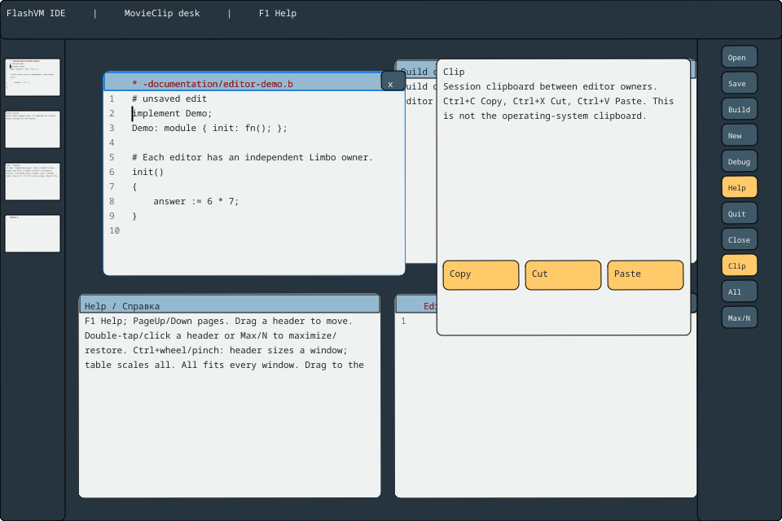

# Desktop gestures and presentation

The desktop now prepares immutable painting commands on its VM owner and draws
only damaged 64×64 tiles on up to four background tile workers. Native typing
is independent of raster completion and SWF FPS. See the ownership, scheduling,
clipping and limitations in [event-driven rendering](../flashVM/doc/RENDER_ASYNC.md).

[Русский](DESKTOP-WORKSPACE.ru.md) · [Desktop](DESKTOP.md) · [Entry points](ENTRYPOINTS.md) · [Session clipboard](DESKTOP-CLIPBOARD.md)

The application is `run-desktop-ide.sh`, build-menu **8**, or `--launch desktop`.
The application policy and document owners run in separate Limbo processes;
FlashVM owns the real MovieClip/TextField presentation. Python is development
verification tooling and is not part of the installed application runtime.

| Input | Result |
| --- | --- |
| Drag a header | Move that window |
| Drag empty central table space | Pan the table vertically |
| Two contacts, dragging over a window body | Move the window without editing its text |
| Three contacts, dragging over a window | Pan the table without editing its text |
| Double-click/tap a header, or right Max/N | Toggle the active window between the visible table extent and its saved normal geometry |
| Drag a window to the left canvas edge | Minimize it into its live left miniature, retaining its pre-drag normal position |
| Tap a miniature, or swipe it right | Restore that owner and scroll its window into view |
| Right All | Restore and fit all open windows by scaling the parent table, preserving model positions |
| Ctrl+wheel or pinch on the table/body | Scale the whole parent table and its windows, preserving model positions |
| Ctrl+wheel over an unobscured header | Change that window's dimensions in 10 percentage-point steps, 50–180% of its responsive grid size |
| Two-contact pinch, at least one contact on a header | Propose the same bounded window-size change |
| Drag a left miniature vertically | Reorder miniature references; document slots and channels remain stable |
| Click the compact right Help button | Hide/restore the existing Help pane without shutting down its owner |

Window geometry uses table coordinates and subtracts the current table scroll
for header admission. Covered headers cannot resize a window behind an overlay.
Window size is independent of source text. This changes window extents; it does
not change document bytes or imply a font-scale operation.

Active windows have a blue outline and paper-colored contents. Windows and
widgets use rounded drawing contours. A separate title strip makes headers
visible. Editor captions retain the filename and dirty `*` indicator and use
red ink. The gutter displays logical source numbers supplied from the pane's
private full source. Wrapped continuations do not invent additional source lines.
The compact right controls are 44×27 pixels, previously 88×54.

During movement the window is rendered at 90% opacity. An unchanged fully painted
window can reuse its copied last image: no live document or GC pointer is stored
in that raster cache. Content, dimensions, selection, caret and source-line origin
must match. A mismatch or unavailable image falls back to real MovieClip painting.
A clipped partial frame is never recorded as a complete snapshot. Every cache is
bounded to 4 MiB per window and is retired with its presentation slot. The normal
complete scene is painted again after release. Immutable glyph outlines are also
cached independently of window translation. Geometry-only motion reuses pane
snapshots rather than polling every source owner.

SDL contact IDs and normalized coordinates remain in the native input owner.
Native single-contact taps and mouse double-click counts use SDL event timestamps,
so a slow paint cannot alter the double-tap interval. Only scalar count/phase/pixel proposals cross the checked channel boundary.
Native focus loss resets contact tracking and cancels input ownership. Normalized
replay verifies real Dis admission, MovieClip geometry, miniature identity and
Help lifetime in both dispatch modes; it is not physical touchscreen acceptance.
Test native-device gesture comfort and frame latency on the deployment hardware.

[Clipboard tutorial](dis/examples/desktop-clipboard/README.md) uses the separate
bounded session clipboard. The desktop's session clipboard is not the operating
system clipboard.

Max/normal stores a separate presentation mode: edits, normal offsets and per-window
size survive it. Resizing the native canvas recomputes maximized extents. Uniform
table zoom is 10–180%; Show all derives a fit from current window bounds. Pane
MovieClips, glyphs, selection and hit transforms share the same parent scale.
Hidden panes remain typed thumbnail sources but are explicitly excluded from
canvas rasterization. Closing still retires the actual pane and its cached data.

Before each desktop frame, SDL collapses up to 256 consecutive absolute motions
from the same pointer/contact. Every key, button release, focus transition or
other contact identity stops that pass. This avoids replaying stale movement
through a frame backlog. The native SDL event-queue check proves that release
ordering is retained. Release coordinates are applied to the final window offset.

[Glass rails, docking and smooth whole-table reveal / Матовые панели и плавный показ окна целиком](DESKTOP-GLASS-MOTION.md).

## Zoom viewport anchor (v0.1697)

Table zoom scales physical scroll/pan from one exact reference anchor while
leaving window rectangles in logical coordinates. Opposite zoom steps restore
the reference without accumulating integer-rounding drift. This also keeps the
header of an already scrolled/maximized window below the top bar. New panning/
scrolling establishes a new reference; existing viewport bounds still apply.
