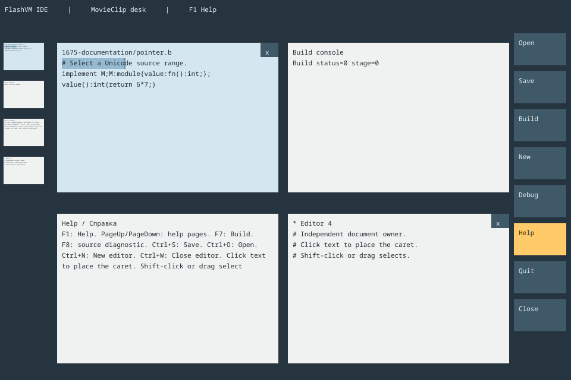

# MovieClip desktop — v0.1675



The WeTab-inspired shell has a vertically scrollable central table, live window
miniatures on the left and expandable tool scrolls on the right. **Every window,
miniature, button, table layer and scroll is an actual FlashVM MovieClip.** Captions
and editor viewports are same-context TextFields retained by their clips. This is
running bytecode, not a screenshot overlay or an HTML mockup.

## Run

Build the matching graphical runtime and execute `desktop-ide.dis` with
`disvm-editor`, or use the installed `run-desktop-ide.sh`. For example:

```sh
sh out/disvm-editor/run-desktop-ide.sh --document example.b
```

A source-built SDL window backend is required for physical interactive windows.
A headless build accepts counted `--events` plus `--capture` for actual FlashVM
raster replay. The existing `ide.dis` application and full single-editor entry
remain available. No compiler CLI, Python, external Inferno emu or browser runs
inside the deployed desktop.

## Actual owners and widgets

| Element | FlashVM representation | Dis owner |
| --- | --- | --- |
| Central table | MovieClip layer with AS `_y` translation | Idedesktop geometry/gesture process |
| Each editor | Independent MovieClip, TextField and caret MovieClip | Its own Idedeskpane, Idecore and optional build-panel processes |
| Build console | Separate MovieClip/TextField | Separate mutable log process |
| Help | Separate MovieClip/TextField and expandable tool | Separate readonly paged help process |
| Miniature | Separate scaled MovieClip/TextField showing the source window's current scene | Copied source-window ID, never a native pointer |
| Tool/scroll | Separate MovieClip instances | Typed admitted action through the desktop process |

Two editors, build console and Help start independently. New creates another
editor without retiring existing documents; this shell bounds the registry to
8 total windows. Clicking a window focuses it. Left miniatures select/jump to the
corresponding table row. Drag **empty** central-table space to pan vertically;
a gesture begun over a window never pans the table. Wheel scrolls the table.
Gestures carry completed-view tickets; stale, invalid, focus-loss and resize
transitions cancel pending gestures.

Keyboard editing, Unicode movement, selection via keyboard and Undo/Redo use the
existing Ideinput/Idecore services. Each editor displays a bounded caret-following
viewport, not a separate native text authority. Ctrl+N creates an editor, Ctrl+O
opens a path field, Ctrl+S saves the focused editor; Ctrl+Shift+S chooses a path.
Open refuses unsaved edits. Save marks only the successfully written editor
revision saved. F7 uses the real library compiler and writes its diagnostic into
the build console. F8 selects an admitted original source diagnostic.

**F1 opens Help.** PageUp/PageDown navigate the focused Help process. Right-side
tools expand a scroll before executing an action. Quit protects all dirty editor
owners; `Discard and close` is an explicit terminal action. The Debug scroll
reports that no debugger is attached and its action is disabled; it creates no
fabricated session.

## AS and native boundary

[desktop-view.as](as/desktop-view.as) is compiled by the existing Coco/R display
profile through FIR, verification/peepholes, SWO and SWL into embedded SWF 8. It
sets actual MovieClip transforms and actual TextField properties. No source parser
or bytecode generator runs during UI presentation.

The owner-only native adapter supplies context-local capabilities and invokes
standard FlashVM createEmptyMovieClip/beginFill/moveTo/lineTo/endFill primitives.
The current bounded AS profile has property assignments, not general function-call
lowering; native primitive adaptation is explicit. All application actions, text,
selection, files, builds, focus and panning stay on ordinary Dis channels.
Neither VM shares managed pointers with the other. Complete scene frames copy
bounded scalar IDs, geometry and UTF-8 values. Native input proposes pixels/phases;
it never edits a document or performs a file/build action directly.

MovieClip drawing currently runs on its FlashVM owner. A detached frame copies the
completed pixels before background presentation; no worker accesses a MovieClip,
TextField, context or Dis owner. This is not parallel MovieClip raster execution.
The older editor's detached-path raster pipeline remains independently tested.

## Current scope

This is the first working multiple-window shell. It has independent keyboard
editors, Open/Save path fields, real Build/F8, build log, paged Help, miniatures and
empty-space panning. It does not yet embed every existing single-editor widget:
clipboard integration, session persistence, window resizing/reorder controls, export controls, graphical document tools and attached
Run/Debug sessions remain work. Existing single-editor/export entries retain
those implemented capabilities. Layout and appearance can now evolve by MovieClip
components without replacing document owners.

The viewport transports up to 200 Unicode scalars per pane around the caret;
source remains in its complete Idecore document. File open is bounded to 64 KiB;
path fields keep the existing 256-scalar limit. Default text size is 11 using the
shipped unmodified Noto Sans Mono/OFL face. Current acceptance is native Linux AMD64
interpreter/JIT plus real FlashVM replay; physical touch/desktop and other OS/CPU
execution are not inferred from replay or foreign-emitter checks.

[Desktop channel contract](dis/bridge/idedesktop.m) · [Pane contract](dis/bridge/idedeskpane.m) ·
[Application](dis/app/desktop.b) · [Tutorial](dis/examples/desktop/README.md) ·
[Build service](COMPILER-SERVICE.md) · [Workspace](WORKSPACE.md).

[Moving, Close/Cancel and window lifetime](DESKTOP-LIFECYCLE.md).

[Glyph caret, Shift-click and selection](DESKTOP-POINTER.md).
