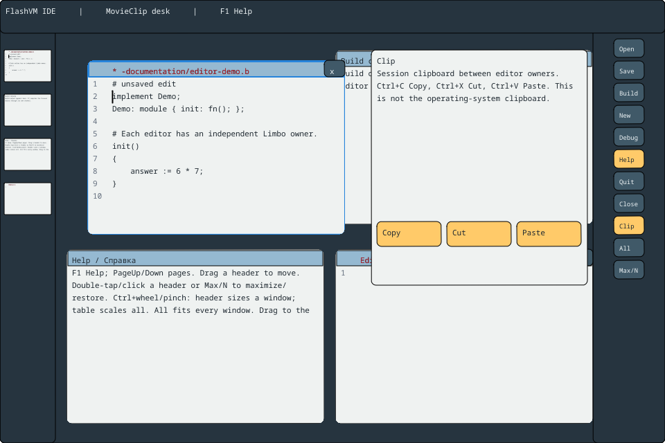

# Рабочий стол на MovieClip — v0.1677

[Workspace gestures / Жесты и оформление](DESKTOP-WORKSPACE.md) · [Русский](DESKTOP-WORKSPACE.ru.md)



Новая оболочка по мотивам WeTab: широкий вертикальный центральный стол, живые
миниатюры слева, разворачиваемые инструменты справа. **Окна, миниатюры, кнопки,
слои стола и свитки — настоящие MovieClip во FlashVM.** Подписи и текстовые области
— TextField, удерживаемые соответствующими клипами. Это исполняемый интерфейс,
не картинка обзора и не HTML-макет.

## Запуск и управление

В установленном графическом SDK: `sh run-desktop-ide.sh --document example.b`.
Точка входа — desktop-ide.dis на disvm-editor. Для физического окна нужен собранный
SDL backend; headless-вариант принимает --events/--capture и действительно рисует
FlashVM. Старые ide.dis и полный одиночный редактор также доступны. Внешние emu,
Python и CLI-компиляторы не входят в исполняемую оболочку.

Цель сборки `disvm-editor` также компилирует `desktop-ide.dis`, примеры desktop
и совместимые импортируемые библиотеки. Это действует и при
`DVM_RUNTIME_TESTS=OFF`: приложения не зависят от архивных тестов.
После изменения интерфейса `.m` пересоберите и переустановите весь пакет.
Старый `desktop-ide.dis` рядом с новыми библиотеками может быть несовместим.
`fail: desktop modules` при запуске означает ошибку одного из начальных
импортов; это сообщение не указывает модуль и не отличает отсутствие файла
от несовпадения интерфейса.

```sh
cmake --build <runtime-build> --target disvm-editor --parallel 4
python3 disVM/runtime/test_desktop_install.py <runtime-build> disVM/runtime/run-desktop-ide.sh
```

Вместо `<runtime-build>` укажите настроенный каталог сборки runtime, а не каталог
установки. [Правила сборки](../disVM/runtime/cmake/DesktopModules.cmake) создают
переносимый байткод. [Проверка установки](../disVM/runtime/test_desktop_install.py)
копирует продукты во временный пакет и запускает штатный launcher из постороннего
рабочего каталога. Она проверяет настоящий рендер, редактирование, сохранение
и подтверждённое завершение с JIT и интерпретатором. Опциональный сервис
компиляции и физическое окно SDL эта проверка не проверяет.

## Ожидание в простое

Нативный контроллер Dis ожидает сигнал работы, когда все клиенты desktop
заблокированы. Его будят ввод от UI, освобождение очереди при показе,
канальные операции гостей и ошибка UI. Повторный неблокирующий проход pump
после выборки поколения пробуждений закрывает гонку между проверкой и ожиданием.
Перед удалением планировщика UI-пробуждения отключаются. Потоки гостей сохраняют
своих владельцев исполнения; глобальной приостановки нет.

Проверка `disvm_editor_idle_cpu` для Linux держит replay FIFO открытым после
первой отрисовки, измеряет CPU процесса две секунды, затем передаёт правку/save/quit
и проверяет сохранённый файл. Потребление выше 15% одного CPU считается ошибкой:
порог допускает шум измерения, но обнаруживает прежний непрерывный опрос.
Локальный headless-замер показал 99,4% до исправления и 0,0% после с точностью
до тиков системных часов. Это не замер физического ввода SDL или анимации.

Изначально открыты два независимых редактора, build-консоль и Help. New добавляет
ещё один редактор, сохраняя существующие документы; предел этой оболочки — 8 окон
всех видов. Клик фокусирует окно. Миниатюра слева переводит к соответствующей строке
стола. Свайп/drag, начатый **на пустом месте**, прокручивает стол вверх/вниз. Жест,
начатый над окном, стол не двигает. Колесо также прокручивает стол. Устаревшие и
невалидные события, потеря фокуса и resize отменяют незавершённый жест.

Ввод, Unicode-навигация, клавиатурное выделение и Undo/Redo выполняются прежними
Ideinput/Idecore. Ctrl+N создаёт редактор; Ctrl+O открывает поле пути; Ctrl+S сохраняет
текущий редактор; Ctrl+Shift+S выбирает путь. Open не теряет несохранённый текст.
Успешный Save меняет saved только соответствующего документа. F7 действительно
вызывает библиотечный компилятор и публикует диагностику в отдельной консоли;
F8 выделяет исходный диапазон допущенной ошибки.

**F1 открывает Help.** В сфокусированном Help работают PageUp/PageDown. Инструменты
справа сначала разворачивают свиток. Quit проверяет dirty всех редакторов; кнопка
Discard and close явно подтверждает закрытие с потерей несохранённых правок.
Debug сообщает об отсутствии подключённой сессии, действие отключено: фиктивного
отладчика оболочка не создаёт.

## Владение и каналы

| Элемент | FlashVM | Limbo/Dis |
| --- | --- | --- |
| Стол | MovieClip со смещением _y из AS | Отдельный владелец геометрии/жестов |
| Каждый редактор | Свой MovieClip, TextField и MovieClip-каретка | Свои Idedeskpane, Idecore и build panel процессы |
| Консоль | Отдельный MovieClip/TextField | Собственный процесс текста журнала |
| Help | Отдельный MovieClip/TextField | Собственный readonly-процесс страниц |
| Миниатюра | Отдельный масштабированный клип с актуальным содержимым окна | Скалярный ID источника, не native-указатель |
| Кнопки/свитки | Отдельные MovieClip | Типизированные запросы и допуск действий |

[AS-представление](as/desktop-view.as) проходит Coco/R → FIR → peepholes → SWO → SWL
→ SWF 8 и исполняется во FlashVM. Оно задаёт настоящие свойства клипов и TextField.
Текущий ограниченный профиль AS поддерживает присваивания свойств; общего lowering
вызовов функций ещё нет. Поэтому адаптер явно предоставляет стандартные примитивы
createEmptyMovieClip/beginFill/moveTo/lineTo/endFill, а не подменяет клипы C-картинкой.

Вся политика документов, окон, фокуса, файлов, сборок и жестов идёт по обычным
Dis-каналам. Каждое окно имеет отдельный Limbo-процесс. Это кооперативные процессы
на нашем VM; нативные компиляция/I/O по-прежнему блокируют владельца. Управляемые
указатели между кучами VM не передаются: сцена содержит ограниченные ID, геометрию
и UTF-8. Native input только предлагает координаты/фазы, не редактирует текст.

MovieClip-рисование пока выполняется на владельце FlashVM. Завершённые пиксели
копируются в отделённый кадр для фонового представления; worker не читает VM/клипы.
Параллельное MovieClip-растеризование не заявляется. Прежний path-raster pipeline
одиночного редактора сохраняет отдельные проверки.

## Границы первого варианта

Реализованы настоящие независимые клавиатурные редакторы, Open/Save, Build/F8,
журнал сборки, Help, миниатюры и прокрутка пустого стола. Пока не перенесены все
виджеты полного одиночного редактора: системный clipboard, сохранение сессии/resize окон, экспорт, графические документы и Run/Debug.
Ранее реализованные одиночные редактор/экспорт доступны через свои точки входа.
Теперь эти части можно добавлять как MovieClip-компоненты и канальные владельцы.

Окно передаёт до 200 Unicode-символов возле каретки; полный исходник хранит Idecore.
Open ограничен 64 КиБ, поле пути — 256 символами. Размер текста 11, шрифт — поставляемый
неизменённый Noto Sans Mono/OFL. Проверены native Linux AMD64 interpreter/JIT и
действительный FlashVM replay. Физические touch/desktop и остальные OS/CPU не
объявляются проверенными по одному replay либо сборке чужого emitter.

[Стол](dis/bridge/idedesktop.m) · [Владелец окна](dis/bridge/idedeskpane.m) ·
[Приложение](dis/app/desktop.b) · [Пример](dis/examples/desktop/README.ru.md) ·
[Компилятор](COMPILER-SERVICE.ru.md) · [Workspace](WORKSPACE.md).

[Перемещение, Close/Cancel и жизненный цикл окон](DESKTOP-LIFECYCLE.ru.md).

[Каретка, Shift-клик и выделение](DESKTOP-POINTER.ru.md).

В конечном build-menu новый стол — пункт **8**, прежний редактор — **9**.
CLI: `python3 build-menu.py --projects disvm-editor --backend cmake --launch desktop`.
[Все точки запуска](ENTRYPOINTS.md).

[Сессионный Copy/Cut/Paste между окнами](DESKTOP-CLIPBOARD.ru.md).
