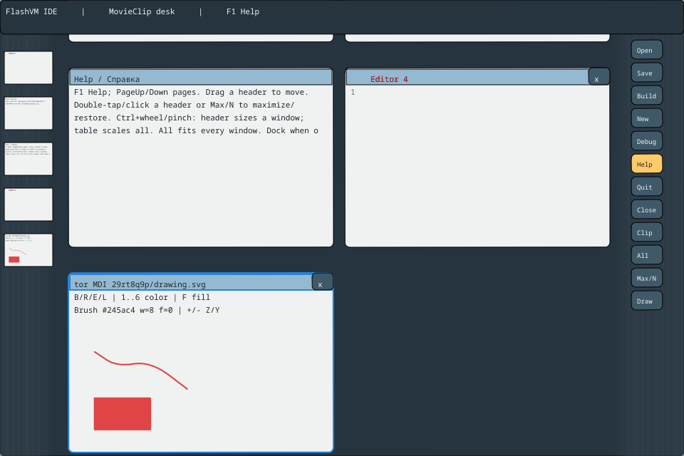

# Векторный редактор в MDI и SVG

[English](VECTOR-EDITOR.md) · [Запуск](ENTRYPOINTS.md) ·
[Рабочий стол](DESKTOP-WORKSPACE.ru.md) · [Пример](dis/examples/vector/README.ru.md)

В v0.1696 добавлен новый тип документа внутри существующей IDE MovieClip,
пункт **8** меню сборки. Нажмите **Draw** справа или **Ctrl+Shift+N**. Каждый
вызов создаёт отдельное MDI-окно; общий лимит редакторов, консоли и справки —
восемь окон. Текст и графика сосуществуют. Работают прежние перемещение,
максимизация, масштаб, миниатюры, сворачивание и раскрытие. Миниатюры показывают
настоящие векторные пути.

Модель, история и SVG исполняются на Limbo/Dis. Владелец контекста FlashVM
получает копии команд и вызывает настоящие методы MovieClip: moveTo, lineTo,
curveTo, lineStyle, beginFill. Готовые контуры копируются в задания существующих
потоков растеризации. У них нет указателей на VM, шрифт или документ. Процессы
Dis планируются отдельно; параллельную работу нескольких VM/GC эта серия не вводит.



## Как рисовать

Выберите инструмент клавишей и тяните мышью по листу под двухстрочной легендой.
Владелец принимает явные Key и асинхронные/пакетные Text-команды SDL.
Сейчас инструменты выбираются клавиатурой; на правой панели есть кнопка создания
Draw. Полная флэшевая панель инструментов и редактор выделенных узлов — следующий
этап, а не уже реализованные возможности.

| Клавиши | Действие |
| --- | --- |
| B | Кисть |
| R | Прямоугольник по противоположным углам |
| E | Эллипс по противоположным углам |
| L | Прямая линия |
| 1–6 | Синий, красный, зелёный, охра, чёрный, фиолетовый |
| F | Заливка замкнутой фигуры тем же цветом |
| + / - | Толщина1..32 единицы документа |
| Ctrl+Z / Ctrl+Y | Отмена/возврат целого завершённого жеста |
| Escape | Отмена незавершённого жеста |
| Ctrl+S | SVG; для нового документа ввод пути |
| Ctrl+Shift+S | Сохранить по другому пути |
| Ctrl+O | Прочитать поддерживаемый SVG в чистый векторный документ |

Координаты листа —0..1000 и0..600. Лист вписывается равномерным масштабом под
легендой, с полем20 логических единиц для толщины обводки. Hit-test использует
реальные составные матрицы MovieClip, включая масштаб окна/стола и прокрутку.
Приложение Limbo дополнительно проверяет актуальный view ticket, верхнее окно и
ревизию документа. Два/три контакта сохраняют существующие жесты окна/стола и
отменяют незавершённую кисть. Выход за лист, потеря фокуса и другая неполевая
команда отменяют незавершённый жест, не рисуя поверх чужого окна.

Один непрерывный штрих одного цвета — **один путь и одна операция Undo**.
Между отсчётами строятся квадратичные кривые через средние точки, с общей
касательной на стыках. Последняя точка отпускания сохраняется. Одиночный щелчок
оставляет точку. При лимите отсчётов старые прореживаются с сохранением концов;
штрих продолжается одним путём, ценой потери мелких деталей. Раздельные нажатия
остаются разными путями даже при пересечении: булево объединение произвольных
областей краски пока не реализовано. Нажим пера, ластик, выделение/редактирование
узлов, слои и анимация также остаются дальнейшей работой.

Прямоугольники состоят из линий и замыкания. Эллипс приближён восемью
квадратичными дугами с пересечением касательных на22,5 градуса. Одинаковые
команды используются при показе, в истории и при SVG-экспорте. Preview не меняет
зафиксированный источник/историю; отпускание фиксирует жест целиком. История
хранит16 Undo и16 Redo неизменяемых состояний. Undo/Redo создаёт новую ревизию
и консервативно помечает документ изменённым, даже при возврате к геометрии
прошлого сохранения. Защита грязного закрытия/выхода общая с текстовыми окнами.

## Чтение и сохранение SVG

Путь с окончанием `.svg` сразу открывается как векторный документ:

```sh
sh out/disvm-editor/run-desktop-ide.sh --document /полный/путь/drawing.svg
```

Первый импортёр намеренно поддерживает **строгое подмножество SVG**:

- Один корень svg, необязательные стандартный xmlns, width1000, height600,
  viewBox=`0 0 1000 600`. При пропуске размеров используется тот же лист.
  Пустой самозакрывающийся корень также разрешён.
- С v0.1697: UTF-8 BOM, XML-декларация1.0 с UTF-8/standalone и корректные
  комментарии между элементами. При каноническом сохранении эта нерисующая
  метаинформация опускается; внешние ресурсы не загружаются.
- Самозакрывающиеся path, rect, ellipse, line; уникальные поддерживаемые
  атрибуты в кавычках, разделённые пробельными символами.
- Явные абсолютные команды M/L/Q/Z; один подпуть, целые координаты внутри
  листа. Запись100.000 принимается как точное целое без округления. Буква
  команды повторяется для каждого сегмента; разделитель — пробел.
- Цвета #rrggbb или none. Заливка и обводка одного пути должны иметь одинаковый
  RGB, если присутствуют обе. По умолчанию заливка чёрная, обводки нет.
  Толщина обводки1..32; у фигуры только с заливкой обводка действительно отключена.
- Атрибуты примитивов: x/y/width/height, cx/cy/rx/ry либо x1/y1/x2/y2.

Неподдерживаемые элементы/атрибуты, DOCTYPE/entities/неизвестные processing instructions,
CSS, transforms, разные цвета заливки/обводки, другой viewBox, ненулевые дроби,
кубические кривые/дуги и несколько подпутей дают **атомарный отказ чтения**.
Они не исчезают молча при последующем сохранении. Импортёр SVG — ограниченный
читатель формата данных; парсеры компиляторов AS/Limbo по-прежнему используют Coco/R.

Экспорт — детерминированные обычные SVG path. Все экспортированные этим
редактором файлы читаются им обратно без изменения канонического SVG. Новый
документ строится до принятия результата; грязный документ отказывает в Open.
Успешный Open увеличивает ревизию окна, очищает историю и отмечает документ
чистым. Save принимает путь/сохранённую ревизию только после успешной записи.
Файловые операции могут блокировать владельца VM. Запись проверяется, но это
**перезапись, не атомарная замена/fsync**: ошибка I/O может оставить частичный
файл. Исходный документ в памяти остаётся для повторного сохранения.

## Ограничения и протокол

Локальные бюджеты: 32 пути,64 команды/путь,512 команд/документ,64 КиБ входного UTF-8 SVG, включая метаданные.
Перед началом жеста резервируются64 команды; отказ возможен консервативно до
полного исчерпания512. Полный поток рисования — не более21 512 ASCII-байтов.

Reply.drawing передаёт полный снимок значениями. Локальные UI-коды65576/65577
передают начало и фрагменты внутри обычного desktop Begin/End. Начало содержит
окно/ревизию/точный размер; фрагмент — тот же view ticket, точный следующий offset
и до1024 байтов. Native adapter проверяет весь поток, стили, команды и границы
до фиксации сцены. Неполный, повторный, переставленный или повреждённый поток не
фиксирует частичную фигуру. Это **не общие ID формата Dis64**. Сигнатуры модулей
расширены: приложение и его .dis/.m нужно собирать/устанавливать комплектом.

## Проверки и исходники

[Модель](dis/bridge/idevector.b), [интерфейс](dis/bridge/idevector.m),
[регрессия модели](dis/tests/idevector_test.b),
[владельцы/ревизии](dis/tests/idevectorpane_test.b),
[проверки native-протокола](../disVM/runtime/test_desktop_vector.c),
[настоящий ввод и пиксели](../disVM/runtime/test_desktop_vector.py).

Проверяются interpreter/JIT, интерполяция/прореживание/фигуры, SVG roundtrip,
отказы без изменения документа, раздельные владельцы, Undo/Redo, реальные
пиксели MovieClip и файловые Save/Open. Replay не заменяет физические устройства
и не является замером задержки ввода. Ленивый Coco/R-анализ текстовых редакторов
остаётся отдельной службой.
